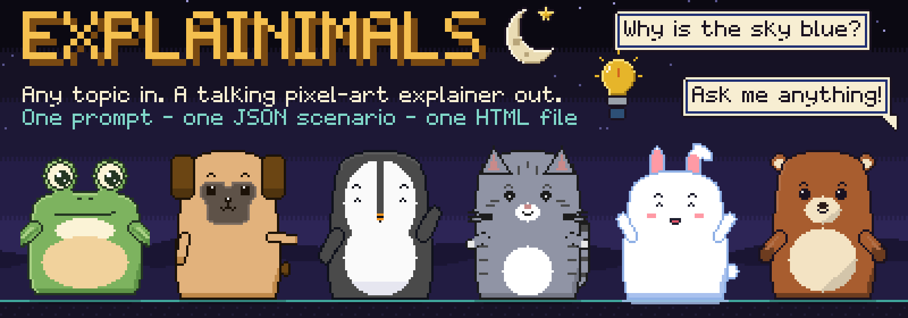

<p align="center">
  
  <br>
  <b>Turn any topic into an animated pixel-art explainer in one file.</b>
</p>

<p align="center">Six pixel-art animals talk through the idea while the camera moves and the music plays.</p>

Explainimals is a skill that turns a topic into a short animated explainer. Your AI agent writes the whole thing as a small JSON scenario, and a built-in engine plays it back as pixel-art animation with talking animals, camera moves, music and sound. The output is one HTML file, so there is no filming, editing or rendering step to wait for.

## Why it is fast

- **The AI writes a plan, not frames.** It writes a small JSON scenario (slides, who says what, props, camera, music) instead of drawing video frames.
- **The engine does the animation.** The file already holds the characters, backgrounds, props, camera moves, pixel art, music and sound.
- **Nothing to edit, record or render.** There is no video editor, no recording and no render queue, so there is no waiting on output.
- **One file that plays at once.** The result is one self-contained HTML file that opens in any browser and works offline.
- **Problems are caught before the build.** A validator tells the AI exactly what to fix, so fixes happen before the file is made.

## How it works

1. **Describe a topic.** Ask in plain words, for example "make an Explainimals about how DNS works".
2. **The AI writes a JSON scenario and checks it.** The validator lists every error and warning, and the AI fixes them before it builds the file.
3. **Open the HTML file and press Play.** Sound stays off until you press Play.

A scenario is plain JSON. This is one slide, with a penguin, a background, a prop and a camera move:

```json
{
  "background": "night-sky",
  "camera": { "focus": "speaker", "zoom": 2, "move": "push-in" },
  "props": [ { "id": "server", "label": "Server" } ],
  "characters": [
    { "skin": "penguin", "at": "left", "expression": "happy", "pose": "point_right",
      "say": "This server stores the page's files." }
  ]
}
```

Any AI that can write JSON and run Node (Claude, Codex or others) can drive it, because the format is plain and the validator explains every error.

## What you get

- **6 animals** (penguin, frog, dog, cat, rabbit and bear), **42 props** and **11 backgrounds**.
- **Camera moves** (punch-in, push-in, pull-out, reveal, pan and drift) and eight slide transitions.
- **Music that follows the story**, with a celebration fanfare on the last slide by default.
- **A thumbnail strip** to jump between slides, plus keys for play, replay, sound, fullscreen and previous or next slide.
- **Length:** a typical explainer runs 45 to 60 seconds of animation. Ask for longer and you get more.
- **One self-contained `.html` file**, with sound off until you press Play.
- **A skill for Claude Code, Claude.ai and the Claude desktop app, and for Codex.**

Pixel art is the one visual style: every character, background, prop and UI piece is drawn from whole pixels. It is plain HTML/JS with no build step and no runtime dependencies.

This repo holds both the skill (`plugin/`) and the studio used to build and tune it (everything else).

## Install

Paste one of these prompts into your AI agent. It installs the skill for you, shows the plan and asks you once before it changes anything.

Claude Code, or any other agent that can run commands:

```text
Install the Explainimals skill from https://github.com/darwiniquina/Explainimals by following https://raw.githubusercontent.com/darwiniquina/Explainimals/main/INSTALL.md
```

Codex, which has a built-in `skill-installer` skill:

```text
Use $skill-installer to install https://github.com/darwiniquina/Explainimals/tree/main/plugin/skills/explainimals
```

Restart the agent afterwards. Only the skill folder (`plugin/skills/explainimals`) is installed; the studio and the source art stay behind. The skill needs Node.js 18 or newer.

The Claude.ai chat and the Claude desktop app cannot run commands, so there is no one-prompt install. [INSTALL.md](INSTALL.md) has the zip steps for those, and manual steps for every other agent.

## Update

Updates are not automatic. To get the latest version, give your AI agent this prompt:

```text
Update the Explainimals skill from https://github.com/darwiniquina/Explainimals by following https://raw.githubusercontent.com/darwiniquina/Explainimals/main/INSTALL.md
```

It checks what is installed and replaces it with the newest version, asking you once first. Restart the agent afterwards. In Claude Code you can also run these two commands yourself:

```bash
claude plugin marketplace update explainimals
claude plugin update explainimals@explainimals
```

For Codex, use the same Codex install prompt as above: the installer replaces the old folder after you confirm. For the Claude.ai chat and desktop app, upload the new zip (see [INSTALL.md](INSTALL.md)).

## Use it

Ask in plain language, for example:

- "make an Explainimals video about how a refrigerator keeps food cold"
- "make a funny explainer for kids about why the ocean is salty"
- "explain how a bill becomes law, with the dog and the rabbit in a conversation"
- "explain why bridges don't fall down using the penguin, bear and cat"
- "make a short 30-second explainer about washing your hands"

To invoke it explicitly, type `/explainimals:explainimals make an explainer about DNS` in Claude Code, or
`$explainimals make an explainer about DNS` in Codex. The output goes to `explainimals-output/<topic>.html` in the
folder you are working in. Open it and press **Play**. Keys: **Space** play/pause, **R** replay, **M** sound,
**F** fullscreen, **Left / Right** previous or next slide.

The last slide plays a short celebration jingle by default; ask for a different ending sound or none (for example "end quietly" or "no celebration sound") and your AI sets `finale`.

Before it builds, your AI shows a short plan (the takeaway, the cast and the slide beats) and asks if you want to change anything. When it finishes, it summarises what the explainer says and asks what to change. Reply with revisions ("make it shorter", "swap the cat for the frog", "slide 4 is too crowded") and it edits the same file and rebuilds it, until you say it is done. Say "just build it" to skip the plan question.

| Animal | Default role |
|---|---|
| Penguin | host: narrates, presents, closes |
| Bear | expert: explains the detail |
| Rabbit | quick questioner: asks what happens next |
| Dog | everyday user who has the problem |
| Cat | careful checker: verifies and reviews |
| Frog | comic reactor: jokes, gets startled |

Limits (v0.2.5): a fixed 240 x 135 pixel stage; 6 characters, 42 props and 11 backgrounds (the generated
`plugin/skills/explainimals/references/catalog.md` lists them); at most 2 characters on screen per slide; a crowded
slide falls back to a bottom caption, hidden prop labels or dropped props, which the validator reports; the output is
an HTML file, not a video file.

## Changing the skill

The studio below is where the characters, props, backgrounds and engine are tuned. The skill folder is generated from
it, so after changing anything in `character/` or `presentation/` run:

```bash
node scripts/package-skill.js
```

This copies the runtime and the example scenarios into `plugin/skills/explainimals`, regenerates the catalog and
validates every example. The instructions the AI reads are edited in place under `plugin/skills/explainimals`
(`SKILL.md` and `references/`, where `direction.md` is the creative guide); `presentation/SCENARIO.md` is the older
engine-format reference. Bump the version in `plugin/.claude-plugin/plugin.json` when you publish.

## The studio (dashboard)

Everything below is the workshop: a dashboard to try characters, build scenes, play scenarios and browse assets.

### Run it

Serve the folder (opening `dashboard.html` directly also works):

```bash
python -m http.server 8765
```

Open http://localhost:8765/dashboard.html. The old `test-runner.html`, `presentation/player.html` and
`presentation/assets-preview.html` are now redirects to the matching dashboard section.

## The dashboard

One page, hash-routed, with a global character picker in the header (used by every section):

| Route | Section | What it does |
|---|---|---|
| `#/home` | Home | counts, the live crew, scenario cards with Play |
| `#/characters` | Characters | Playground (expression, pose, behaviour, part overrides, colours) and Gallery |
| `#/scenes` | Scenes | scene maker for one character: row builder (with per-scene action and zoom) + JSON editor, play, download/load `.json` |
| `#/presentations` | Presentations | scenario player: library, scrub, slides, speed (0.5x, 1x, 2x), Loop slide, JSON editor, fullscreen, `?scenario=ID&autoplay=1` |
| `#/assets` | Assets | backgrounds, props, pixel font and UI pieces, with filter and copy-name |

```
dashboard.html             page + script order
dashboard/dashboard.css    pixel UI and the shared px-* classes
dashboard/shell.js         window.Dashboard: register(), routing, skin picker, shared state
dashboard/views/*.js       home, characters, scenes, presentations, assets
```

Adding a section: write `dashboard/views/<id>.js` calling
`Dashboard.register({ id, title, order, mount(ctx) { ...; return cleanup; } })` and add a `<script>` tag to
`dashboard.html`. `ctx` gives you `root`, `query`, `state`, `on('skin', fn)`, `setStatus`, `navigate`.

## Characters

Six native pixel-art characters share one rig and one scene format. Each is a 61x76 grid drawn in code.

| Skin id | Character |
|---|---|
| `penguin` | Penguin, navy and cream with an orange beak |
| `frog` | Frog, green with eyes on top of a wide head |
| `dog` | Dog, brown floppy ears and a cream face stripe |
| `whisker` | Cat, a plain orange cat with whiskers and a curled tail |
| `rabbit` | Rabbit, tan-brown with tall ears |
| `bear` | Bear, warm brown with a cream muzzle and belly |

```
character/parts.js        shared vocabulary: expression and pose names, talk shapes
character/skin-*.js       one file per character (sprites authored as text grids, arms redrawn per angle)
character/character.js    the rig: new Character(el, { skin }).apply({...}); tick(dt)
```

Expression and pose names are the same for every skin, so one scene list drives any character. Unknown names
throw an error listing the valid ones. To add a character, copy the closest `skin-*.js`, change the art and the
colour-class prefix (class names are global), and add a `<script>` tag to `dashboard.html`
(plus the id to the six-skin list in `dashboard/shell.js`).

### Scene format

```json
{ "narration": "...", "expression": "happy", "pose": "wave", "talking": true,
  "look": { "x": 0.5, "y": 0 }, "eyes": "wide", "brows": "raised", "mouth": "O", "duration": 3 }
```

Two optional scene fields, `action` (one of `Character.actions`, played when the scene starts) and `zoom` (1, 2 or 3,
an integer enlargement that centres on the head at 2 or 3), are set with selects in the Scenes view.

### Conventions

- `L` / `R` are the viewer's left / right.
- Arm angles: `s` = shoulder (0 down, 90 out to the side, 180 up).
- Time advances only through `tick(dt)`, so a frame-by-frame renderer gets identical output. Animation runs in fixed steps (default 12 fps).
- Motion is rounded to whole pixels.

## Presentations (scenario player)

A whole explainer is one JSON **scenario** (slides, characters, speech, props, panels, backgrounds, camera, character motion and emotes); see
`presentation/SCENARIO.md` (format and authoring guide) and `presentation/CONTRACT.md` (240x135 stage, art rules).

```
presentation/pixel.js         Pres.Buf: the pixel buffer everything is drawn into
presentation/registry.js      registerBackground / registerProp / Pres.catalog()
presentation/font.js, ui.js   pixel font, speech bubble, bullet panel, title card, labels
presentation/backgrounds.js   11 retro scenes
presentation/props.js         42 retro icons
presentation/emotes.js        8 retro icons drawn above a character's head
presentation/engine.js        Pres.validate(scenario), Pres.Player (fixed 12 fps steps), camera and character motion
presentation/audio.js         Pres.audio: Web Audio music and sound effects (no files)
presentation/AUDIO.md         sound contract: API, scenario fields, UI
presentation/scenarios/       web-trip (penguin), sky-blue (cat + frog), how-claude-works (penguin, rabbit, bear, dog),
                             how-claude-works-cinematic (camera, motion and emotes),
                             code-review-chat (all six characters, dialogue blocks: 'The code review')
```

`samples/` holds a demo made with the skill (`sleep-recharges-brain`: the home, office, lab and city backgrounds, eleven of the newer props and a music arc); it is not shipped with the skill, and the dashboard lists it in Presentations.

`presentation/archive/` keeps earlier soft/pastel backgrounds, props and UI (`*.soft.js`); nothing loads them.
Art direction: retro 8/16-bit console look (limited saturated palette, dark outline, 2-3 tone shading, dithered
skies, square-cornered windows), no pastel pink/lavender, no kawaii details.

## Sound

Presentations have optional music and sound effects (`presentation/audio.js`, contract in `presentation/AUDIO.md`).
Everything is generated in the browser with the Web Audio API, so there are no audio files, downloads or licences
to track.

- Music moods: `calm`, `upbeat`, `tense`, `playful`, and `celebrate` (the fanfare, last slide only). Sound effects (ten): `blip`, `pop`, `jump`, `coin`,
  `confirm`, `error`, `whoosh`, `typing`, `talk`, `appear`.
- Presentations view: a **Sound** button (toggles mute, shows On or Off), a volume slider, a "now playing" label,
  and the `M` key toggles mute. Sound is silent until you press Play.
- Assets view: a **Sounds** section to try each effect and each music track (with its bpm).
- Scenarios: a top-level `music` field and per-slide `music` and `sfx` fields. See `presentation/SCENARIO.md`.

**Talking.** A `say` line is typed out letter by letter in its speech bubble, and each character has its own voice: a short blip per letter, so the speaker seems to talk. Like the rest of the sound, the voices are generated in the browser with no files. The Assets view's **Sounds** section lets you hear the six voices.

**Conversations.** A scenario can be a conversation: a `dialogue` block lists the cast and the lines, and the engine turns each line into a slide (see `presentation/SCENARIO.md`). The voices are expressive too: a happy line sounds brighter, a sad one slower and lower, and a question rises at the end. The example scenario 'The code review' (`presentation/scenarios/code-review-chat.js`) is a three-part conversation with all six characters.

## Camera and motion

Slides can move the camera and animate the characters. The full format is in `presentation/SCENARIO.md`; the
art rule that allows integer zoom only is in `presentation/CONTRACT.md`.

- **Camera**: `focus` (the speaker, a side, the face, a prop or a point), `zoom` 1, 2 or 3, and a `move`
  (`punch-in`, `push-in`, `pull-out`, `reveal`, `pan`, `drift`). Optional `shake` and `letterbox`. A zoomed bubble
  becomes a caption.
- **Transitions**: `iris`, `flash`, `checker`, `fade-black` and `wipe-down`, alongside `cut`, `dissolve` and `wipe`.
- **Character motion**: `enter` and `exit`, `walkTo` with a waddle, `gaze`, five body `action`s (`nod`, `shake`,
  `hop`, `recoil`, `shiver`), eight `emote` icons above the head, and eight new poses.
- **Player**: the Presentations view has a Speed select (0.5x, 1x, 2x) and a Loop slide checkbox.

```json
{ "id": "bug", "transition": "iris",
  "camera": { "focus": "speaker", "zoom": 2, "move": "push-in", "shake": { "at": 1.2 } },
  "characters": [
    { "skin": "bear", "at": "left", "expression": "surprised", "pose": "facepalm",
      "say": "The test failed, and it fails every time!", "enter": "hop",
      "action": "recoil", "emote": { "id": "exclamation", "at": 0.3 } }
  ] }
```

## Next steps

- Wrap `Character` and `Pres.Player` in a Remotion component (`tick(1 / fps)` per frame). Camera moves, shake and
  character actions are already driven by time, so they should render the same way.
- Check the new camera moves and emotes in `presentation/assets-preview.html` before using them in a long scenario.
- Done: the scenario authoring guide, including the camera and motion advice, is packaged as the Explainimals skill in `plugin/` (see "Install").
- Next for the skill: more props (moon, bed, clock, battery, food), a video export, and a license.
